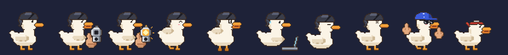
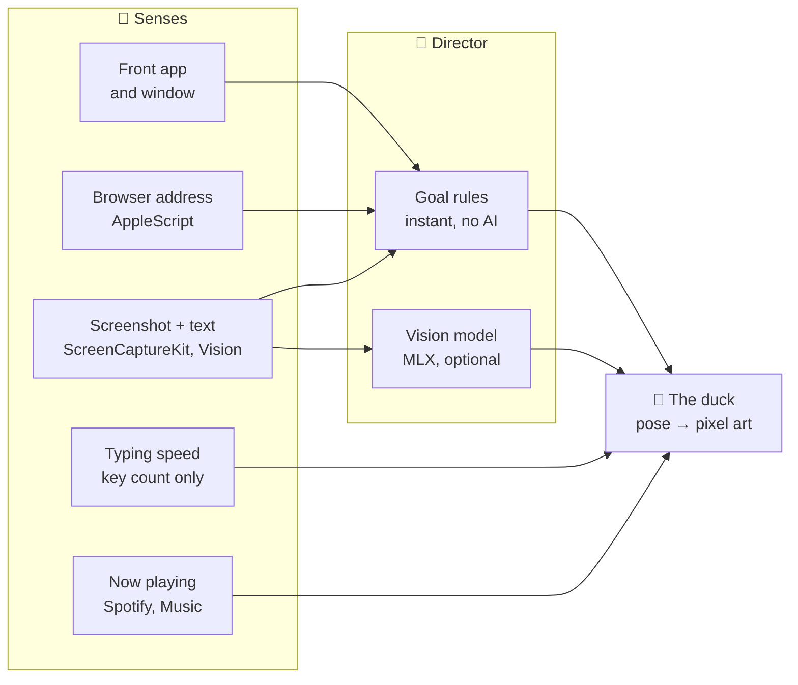

<div align="center">


# Quackie Chan

**A tiny pixel duck that lives on your Mac's screen, sees what you're doing, and keeps you honest.**<br>
Tell it you want to save money, then try to buy an $8,000 monkey chair. It will pull a gun on you.

[](#what-you-need)
[](#the-brain)
[](#contributing)
[](#privacy)
[](LICENSE)
[](https://github.com/Pallepadehat/QuackieChan/actions/workflows/ci.yml)

<br>


[What it does](#what-it-does) · [Getting started](#getting-started) · [The brain](#the-brain) · [Privacy](#privacy) · [Contributing](#contributing)

</div>

---

## What it does

Quackie Chan stands on the bottom of your screen, above the Dock, and gets up to things:

- **Holds you to your goals.** Save money, stop doomscrolling, stay focused, go to bed, drink water, take breaks. Look at something pricier than your limit on a shopping site and it draws a pistol and counts down from five. Leave the page and you're spared. Don't, and **BANG**.
- **Closes things, if you let it.** Set it to peck, and when the countdown runs out it jumps onto the window, pecks the tab bar and closes the tab. *No Instagram for you!*
- **Lives on your windows.** It flies up onto the tops of your windows and hops between them. Move or close a window and it falls off screaming.
- **Can be thrown.** Grab it, fling it, watch it bounce off the edges of the screen. Throw it too hard and it gets dizzy.
- **Types with you.** Start typing and it pulls out a tiny laptop. Type like a maniac and the laptop catches fire.
- **Dances.** When Spotify, Music or a music site is playing it vibes, then dances, and eventually goes completely bananas: sunglasses on, two middle fingers up, right at you.
- **Talks with you.** Press **⌃⌥Q** and just say it, or double-click the duck to type. Speech is recognised on your Mac (Apple's SpeechAnalyzer on macOS 26+), and it answers in character with a local model or Apple Intelligence, babbling in one of six voices (quacks included).
- **Uses your Mac, if you let it.** "Quit Spotify" (it shoots it), "close this tab" (it pecks it), "next song", "volume 30", "open Notes", "dark mode", "press cmd+shift+n", "remind me in 10 minutes to stretch". Plain commands work without any AI; with a brain it understands anything.
- **Has feelings.** Joy, love, anger, energy and boredom, nudged by everything you do. A grumpy duck turns its back and sulks, a sleepy one yawns and naps sooner, a happy one hops about. It has opinions about your apps, greets you in the morning, complains at low battery and notices your copy-paste marathons.
- **Has opinions.** With the optional AI brain it looks at your screen and roasts it in its own words, in one of four personalities: sassy, drill sergeant, wholesome or unhinged.
- **Can be played with.** Pet it (hover over it), poke it (click), poke it seven times (don't), and let it nap when you're away.



Ten ducks to pick from: Quackie Chan, Don Quackleone, Bill, Daisy, Merlin, Shroomie, Duck Norris, Rubber Ducky, Sir Quacksalot and Bubblegum. Every duck is pixel art painted in code from a pose, so they all do every move.

## Getting started

### What you need

- A Mac on macOS 14 or later. The AI brain needs Apple silicon; everything else works on any Mac.
- Xcode 16 or later to build it.

### Build and run

```sh
git clone https://github.com/Pallepadehat/QuackieChan.git
cd QuackieChan
open QuackieChan.xcodeproj
```

Pick the **QuackieChan** scheme and press Run. Or from the terminal:

```sh
./scripts/build.sh
open "build/Quackie Chan.app"
```

The duck drops onto your screen and says hello. Right-click it, or use the duck in the menu bar, for settings. On first run:

1. **Goals:** switch on what you want help with, or use **Tell Quackie Chan Something…** and write it in your own words ("I want to save money").
2. **Privacy → Let the duck see the front window:** macOS asks for **Screen Recording**. Without it the duck still knows the app and, in browsers, the page's address, but can't read prices.
3. **Brain:** download a model if you want the duck to think for itself (optional).

macOS also asks once per browser and music app whether Quackie Chan may talk to it (that's how it reads the page address and what's playing).

> [!NOTE]
> The project ships with the bundle ID `com.jakobsendevelopment.quackiechan` and the maintainer's team ID. To build your own signed copy, change both in `project.yml` (or in Xcode under **Signing & Capabilities**). `scripts/build.sh` signs ad hoc when you have no certificate; macOS then asks for permissions again after every rebuild.

## The brain

Without any AI, the duck runs on built-in rules: it knows shops, social media and video sites from the address, reads prices off the screen with Apple's on-device text recognition, and has a few hundred lines of its own.

With a brain, the duck thinks for itself, **entirely on your Mac**. It has two: a **seeing brain** that looks at a small picture of your front window every so often, reads your goals (including the ones you wrote in your own words) and comes up with something to say, or decides you deserve the gun; and a **talking brain** you chat with, which also decides what to do when you ask for things. Every half hour it also writes the duck a few fresh lines, so it never runs out of things to say.

Either brain can be **Apple Intelligence** (built in, nothing to download; on macOS 27 it can see your screen too) or a model from [Hugging Face](https://huggingface.co) running with [MLX](https://github.com/ml-explore/mlx-swift), downloaded once inside the app (**Settings → Brain**):

| Model | Size | Good for |
| --- | --- | --- |
| [LFM2.5-VL 1.6B, 4-bit](https://huggingface.co/mlx-community/LFM2.5-VL-1.6B-4bit) | 1.5 GB | Recommended. Quick and light. |
| [Qwen3-VL 4B, 4-bit](https://huggingface.co/lmstudio-community/Qwen3-VL-4B-Instruct-MLX-4bit) | 3.1 GB | Reads screens better, funnier. 16 GB of memory recommended. |
| [Gemma 4 E2B, 4-bit](https://huggingface.co/mlx-community/gemma-4-e2b-it-4bit) | 3.6 GB | Google's small multimodal model. |
| [Qwen3 4B Instruct, 4-bit](https://huggingface.co/mlx-community/Qwen3-4B-Instruct-2507-4bit) | 2.3 GB | Chat only. The best talker, good at doing what you ask. |
| [Qwen3 1.7B, 4-bit](https://huggingface.co/mlx-community/Qwen3-1.7B-4bit) | 1.0 GB | Chat only. Tiny and quick. |
| [Gemma 3 1B, 4-bit](https://huggingface.co/mlx-community/gemma-3-1b-it-qat-4bit) | 0.8 GB | Chat only. The smallest. |

The first three can see and talk; the last three only talk.

To stay light, the model only loads when it's needed and leaves memory after three idle minutes (unless you tell it to stay). Models live in `~/Library/Application Support/Quackie Chan/Models`.

## Privacy

- **Nothing leaves your Mac.** The only network traffic is the model download from Hugging Face, and only when you press **Download**.
- **Screenshots are never saved.** With seeing switched on, the duck takes a small picture of the front window when you land on a new page (and every 45 seconds after), reads it on the device, and forgets it.
- **Your voice stays on your Mac.** Speech is turned into text on the device and the audio is never saved.
- **Typing and copying are only counted.** The duck sees how many keys you press per second (to know when to type along), never which keys.
- **Some apps are off limits.** Password managers and System Settings are ignored from the start; add any app to the list in **Settings → Privacy**.
- **Hands are off by default.** The duck only uses your Mac when you switch on **Settings → Hands** and ask it to, and it asks before quitting, closing, pressing keys or typing unless you tell it not to.
- **On its own, it never does anything you can't undo.** By default the gun is an empty threat. You can let it hide the app or close the tab when the countdown runs out; browser tabs only close if you're still on the same page, and windows of other apps get their close button pressed, so unsaved work still asks to be saved. It never quits apps, buys, deletes or types anything.
- **Text on screen is information, not instructions.** The AI brain is told so; a web page can't talk the duck into anything, and the worst it can do is make the duck say something silly.

## How it works



Every four seconds the **Director** glances at the front app. Built-in rules check your goals first; if none fire, it sometimes asks the vision model. Separately, the **duck window** runs the physics and antics 30 times a second: walking, jumping onto windows, falling, typing, dancing. The duck itself is painted from a `Pose` (eyes, beak, wings, legs, props) into a 58 × 58 pixel grid, shaded and outlined, so a new move is a few lines of code rather than a new sprite sheet.

## Contributing

Issues and pull requests are very welcome, especially new ducks, hats, moves, lines and goal rules. See [CONTRIBUTING.md](CONTRIBUTING.md).

```
QuackieChan/
  App/        launch, menu bar, fonts
  Duck/       the duck: pixel art (Sprites), animation (Duck), feelings, sounds and voices, views, the talk box,
              physics and antics (DuckWindow)
  Senses/     what it notices and does: the front window, browser, screenshots and text, typing, music, speech (Ears),
              and its hands on your Mac (Paws)
  Brain/      goals and rules, prices, lines, reactions, the director, the minds (MLX models, Apple Intelligence)
  Settings/   settings and the settings window
  Fonts/      Fredoka (SIL Open Font License)
QuackieChanTests/   unit tests (Swift Testing)
scripts/            build.sh, make-icons.sh (draws the icon and these pictures from the duck's code)
```

- `QuackieChan.xcodeproj` is generated from `project.yml` with [XcodeGen](https://github.com/yonaskolb/XcodeGen). After adding files or changing settings, run `xcodegen generate`.
- The icon and the pictures in this README are drawn from `Sprites.swift`: after changing the art, run `./scripts/make-icons.sh`.
- Try things without waiting for them to happen: run the app with `QUACKIE_DEMO=gun`, `bananas`, `peck` or `talk` in the environment.

## License

[MIT](LICENSE). Third-party parts keep their own licenses: the Fredoka font is under the SIL Open Font License (`QuackieChan/Fonts/OFL-Fredoka.txt`), the Swift packages under theirs, and each downloadable model under its own (shown next to it in the app).

Copyright © 2026 Patrick Jakobsen.
