<div align="center">

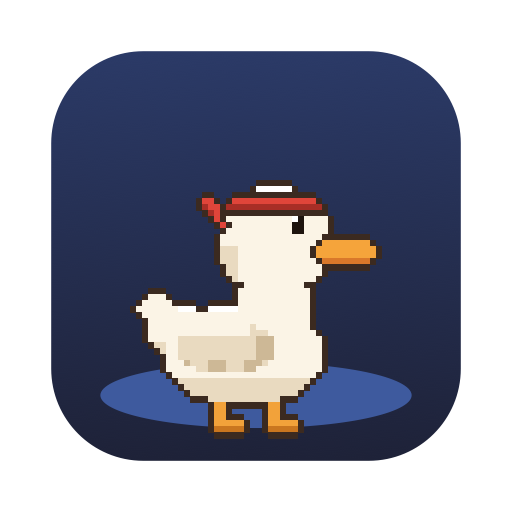

# Quackie Chan

### A tiny pixel duck that lives on your Mac and keeps you honest.

Tell it you want to save money. Then try to buy an $8,000 monkey chair.<br>
It will pull a gun on you.

[](#-get-it-running)
[](#-privacy)
[](#-contributing)
[](LICENSE)
[](https://github.com/Pallepadehat/QuackieChan/actions/workflows/ci.yml)
[](https://quackie-chan.vercel.app)

<br>

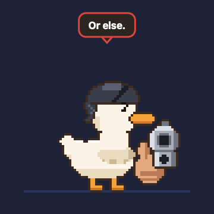 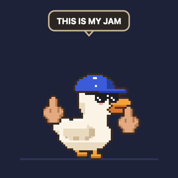 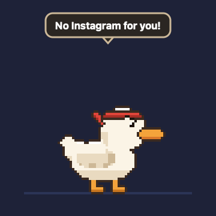

**[Website](https://quackie-chan.vercel.app)** · **[Get it running](#-get-it-running)** · **[What it does](#-what-it-does)** · **[Talk to it](#-talk-to-it)** · **[The brain](#-the-brain)** · **[Privacy](#-privacy)** · **[Contributing](#-contributing)**

<br>

<a href="https://buymeacoffee.com/patrickjakobsen"></a>

</div>

<br>

## 🦆 What it does

Quackie Chan stands at the bottom of your screen, above the Dock, and gets up to things. It comes along to every desktop and every screen.

<table>
<tr>
<td width="33%" align="center"></td>
<td width="33%" align="center">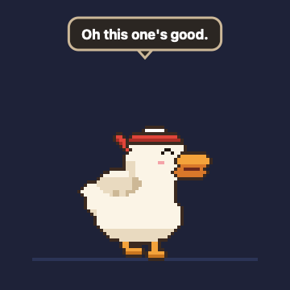</td>
<td width="33%" align="center">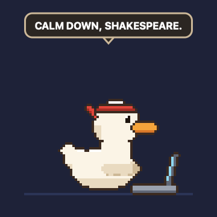</td>
</tr>
<tr>
<td valign="top"><b>Keeps you to your goals</b><br>Save money, stop doomscrolling, stay focused, go to bed. Break a goal and it counts down from five. Leave the page and you live. Don't, and <b>BANG</b>.</td>
<td valign="top"><b>Dances to your music</b><br>Spotify, Music or a music site. It vibes, then dances, then goes completely bananas: shades on, middle fingers up.</td>
<td valign="top"><b>Types along with you</b><br>Start typing and it pulls out a tiny laptop. Type like a maniac and the laptop catches fire.</td>
</tr>
<tr>
<td width="33%" align="center">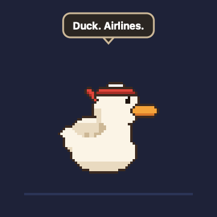</td>
<td width="33%" align="center"></td>
<td width="33%" align="center">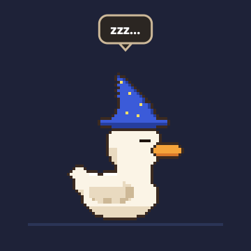</td>
</tr>
<tr>
<td valign="top"><b>Lives on your windows</b><br>Flies up onto them and hops between them. Move the window and it falls off. Grab it and throw it across the screen.</td>
<td valign="top"><b>Closes distractions</b><br>If you let it, it flies onto the window and pecks the tab closed. <i>No Instagram for you!</i></td>
<td valign="top"><b>Has a life of its own</b><br>Naps when you're away, sulks when you poke it too much, has opinions about your apps and greets you in the morning.</td>
</tr>
<tr>
<td width="33%" align="center">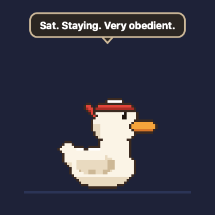</td>
<td width="33%" align="center">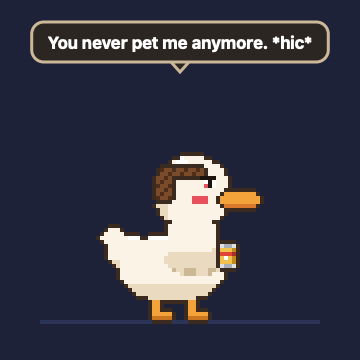</td>
<td width="33%" align="center">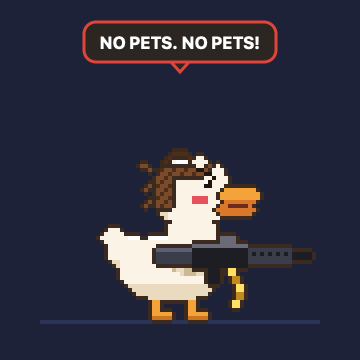</td>
</tr>
<tr>
<td valign="top"><b>Sits when told</b><br>Right-click it → <i>Sit</i>, or just say "sit". It stays put until you tell it anything else.</td>
<td valign="top"><b>Drinks when you ignore it</b><br>Forget to pet it and it cracks open a beer. Then another. Red face, hiccups, slurring, a monk's haircut, cans all over the floor.</td>
<td valign="top"><b>Gets a machine gun when it's wasted</b><br>Try to pet a completely wasted duck and it shoots your cursor across the screen. Bread, coffee and pets sober it up.</td>
</tr>
<tr>
<td width="33%" align="center">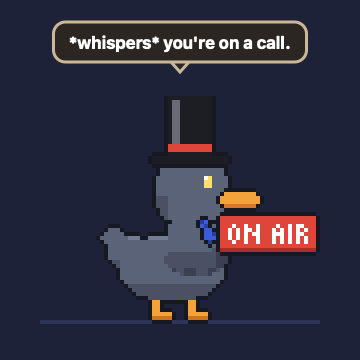</td>
<td width="33%" align="center">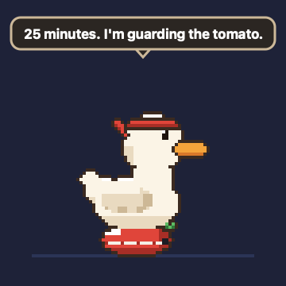</td>
<td width="33%" align="center">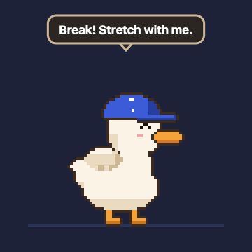</td>
</tr>
<tr>
<td valign="top"><b>Behaves in meetings</b><br>Camera on, or a meeting app using the mic? It puts on a tie, holds up an <b>ON AIR</b> sign and doesn't make a sound until the call's over. If it's had a few, it hiccups anyway.</td>
<td valign="top"><b>Times your focus</b><br>Right-click → <i>Tricks</i> → <i>Focus Timer</i>, or say "focus timer". It sits on a tiny tomato for 25 minutes while the time ticks down in the menu bar.</td>
<td valign="top"><b>Makes you stretch</b><br>When the timer rings, it does stretches and you're meant to join in. Keep typing through them and it sulks.</td>
</tr>
<tr>
<td width="33%" align="center">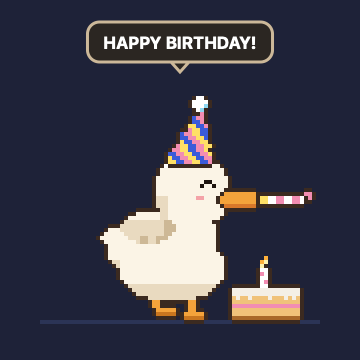</td>
<td width="33%" align="center">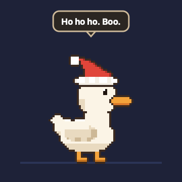</td>
<td width="33%" align="center"></td>
</tr>
<tr>
<td valign="top"><b>Remembers your birthday</b><br>Say "my birthday is 5 March" and on the day it shows up in a party hat with a cake and a party horn.</td>
<td valign="top"><b>Dresses up</b><br>A Santa hat all December, a pumpkin on its head in Halloween week.</td>
<td valign="top"><b>Has friends. Sort of.</b><br>Now and then another duck flies in. They gossip about you in speech bubbles, then it ends in a fight. Doomscroll too long and it leaves a little poop on the window. And there's an old-school cheat code in there somewhere.</td>
</tr>
</table>

**Right-click the duck** for tricks (dance, go bananas, fly, nap, the focus timer, invite a friend), treats (🍞 bread, ☕️ coffee, 🍺 beer) and to clean up its empty cans and whatever else it left behind. When there's no room to stand on a window at the top of the screen, it hangs off the edge instead.

**Ten ducks, four personalities.** Pick your duck and whether it's 💅 sassy, 🪖 a drill sergeant, 🌷 wholesome or 🌀 unhinged.

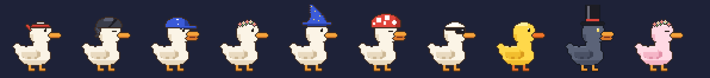

<br>

## 🚀 Get it running

You need a Mac on **macOS 14 or later**. The AI brain needs Apple silicon; everything else works on any Mac.

### Install it

Paste this into Terminal:

```sh
curl -fsSL https://raw.githubusercontent.com/Pallepadehat/QuackieChan/main/install.sh | bash
```

It downloads the latest release, puts Quackie Chan in your Applications folder (replacing an older copy), and opens it. After that the duck keeps itself up to date: when a new version is out, it tells you, and one click installs it.

<details>
<summary><b>Or use the .dmg</b></summary>
<br>

Download **QuackieChan.dmg** from the [latest release](https://github.com/Pallepadehat/QuackieChan/releases/latest), open it and drag the duck into Applications.

Releases aren't notarized by Apple yet, so the first time, macOS says it can't check Quackie Chan for malware. Click **Done**, then open **System Settings → Privacy & Security**, scroll down and click **Open Anyway**. Or run:

```sh
xattr -dr com.apple.quarantine "/Applications/Quackie Chan.app"
```

The install script does this for you. It's [short and readable](install.sh), if you'd like to check it first.

</details>

### Build it yourself

You need **Xcode 16 or later**.

```sh
git clone https://github.com/Pallepadehat/QuackieChan.git
cd QuackieChan
open QuackieChan.xcodeproj    # then press ⌘R
```

Or build it from the terminal with `./scripts/build.sh`, then `open "build/Quackie Chan.app"`.

The duck drops onto your screen and says hello. **Right-click it** (or click the duck in the menu bar) for everything else.

### First five minutes

1. **Pick your goals.** Settings → Goals. Or just tell it: right-click → *Tell Quackie Chan a Goal…* → "I want to save money".
2. **Let it see.** Settings → Privacy → *Let the duck see the front window*. Without this it can't read prices.
3. **Give it a brain** (optional). Settings → Brain → *Get* a model, or use Apple Intelligence.
4. **Talk to it.** Press **⌃⌥Q** and say something.

<details>
<summary><b>Which permissions does it ask for, and why?</b></summary>
<br>

| Permission | What for | Needed? |
| --- | --- | --- |
| **Screen Recording** | Looking at the front window to read prices and see what you're doing | For seeing |
| **Microphone** | Hearing you when you talk to it | For talking |
| **Accessibility** | Pressing shortcuts, typing, and closing windows of apps that aren't browsers | For hands |
| **Automation** (per app) | Asking your browser which page you're on, your music app what's playing | Asked when used |

Every permission is optional. The duck just does less without it.

</details>

> [!NOTE]
> The project ships with the bundle ID `com.jakobsendevelopment.quackiechan` and the maintainer's team ID. To sign your own copy, change both in `project.yml` (or in Xcode under **Signing & Capabilities**).

<br>

## 💬 Talk to it

Press **⌃⌥Q** and just talk, or right-click the duck → *Talk*. It hears you on your Mac and answers in character, with a real quack for every word (or another voice, or none: Settings → Duck).

It can **see your screen**, so you can ask what it thinks of what you're doing. Something like:

> **You:** what do you think of this design?<br>
> **🦆:** The button's fine. The four fonts are a cry for help.

Ask it to show off, any time: **"shoot me"**, **"go bananas"**, **"dance"**, **"fly"**, **"jump"**, **"come here"**, **"quack"**. Dare it and it might just do it on its own.

Say **"sit"** (or "stay") and it sits until you say anything else; **"stand up"** gets it going again. Offer it **"bread"**, **"coffee"** or **"a beer"**. Say **"focus timer"** (and **"stop the timer"**), **"invite a friend"**, or **"my birthday is 5 March"**.

And with **Hands** switched on (Settings → Hands), it can **do things on your Mac**:

| Say | It does |
| --- | --- |
| "Quit Spotify" | Pulls the gun and shoots the app (it quits) |
| "Close this tab" | Flies onto the window and pecks it closed |
| "Next song" · "Pause" · "Play Daft Punk" | Controls Spotify or Music |
| "Volume 30" · "Louder" · "Mute" | Sets the volume |
| "Open Notes" · "Open github.com" · "Search for duck facts" | Opens apps and websites |
| "Hide Slack" · "Minimize" · "Fullscreen" · "Dark mode" | Tidies up |
| "Press cmd+shift+n" · "Type hello" | Keyboard shortcuts and typing |
| "Remind me in 10 minutes to stretch" | Shouts at you in 10 minutes |
| "My name is Sam" · "Remember that I hate Mondays" | Remembers it, for good |

Plain commands like these work even without an AI brain. It asks before anything drastic, unless you tell it not to.

<br>

## 🧠 The brain

Without AI, the duck runs on built-in rules: it knows shops, social media and video sites by their address, reads prices with Apple's on-device text recognition, and has a few hundred lines of its own.

Give it a brain and it thinks for itself, **entirely on your Mac**:

- 👀 **The seeing brain** glances at your front window now and then and comes up with something to say, or decides you deserve the gun.
- 💬 **The talking brain** is who you chat with, and decides what to do when you ask for things.

Either can be **Apple Intelligence** (built in, nothing to download) or a model from **[Hugging Face](https://huggingface.co)**, run with **[MLX](https://github.com/ml-explore/mlx-swift)** and downloaded inside the app.

<details>
<summary><b>The models</b></summary>
<br>

| Model | Size | Sees? | Good for |
| --- | --- | :---: | --- |
| [LFM2.5-VL 1.6B](https://huggingface.co/mlx-community/LFM2.5-VL-1.6B-4bit) | 1.5 GB | ✅ | Quick and light |
| [Qwen3-VL 4B](https://huggingface.co/lmstudio-community/Qwen3-VL-4B-Instruct-MLX-4bit) | 3.1 GB | ✅ | Reads screens well, funnier. 16 GB of memory recommended |
| [Qwen3-VL 8B](https://huggingface.co/mlx-community/Qwen3-VL-8B-Instruct-4bit) | 5.8 GB | ✅ | Sharp eyes: small print, menus, dense pages. 16 GB |
| [Qwen3.5 9B](https://huggingface.co/mlx-community/Qwen3.5-9B-4bit) | 6.0 GB | ✅ | **Best eyes** that fit most Macs. Sees and reasons. 16 GB |
| [Qwen3.6 35B-A3B](https://huggingface.co/mlx-community/Qwen3.6-35B-A3B-4bit) | 20.4 GB | ✅ | Galaxy brain, still quick (3B active). 32 GB+ |
| [Gemma 4 E2B](https://huggingface.co/mlx-community/gemma-4-e2b-it-4bit) | 3.6 GB | ✅ | Google's small multimodal model, smart all-rounder |
| [Qwen3 4B Instruct](https://huggingface.co/mlx-community/Qwen3-4B-Instruct-2507-4bit) | 2.3 GB | — | The best talker |
| [Qwen3 1.7B](https://huggingface.co/mlx-community/Qwen3-1.7B-4bit) | 1.0 GB | — | Tiny and quick |
| [Gemma 3 1B](https://huggingface.co/mlx-community/gemma-3-1b-it-qat-4bit) | 0.8 GB | — | The smallest |

To stay light, a model only loads when it's needed and leaves memory after three idle minutes. Models live in `~/Library/Application Support/Quackie Chan/Models`.

</details>

### How it sees

When you ask about the screen, the duck takes a good look, not a glance:

- 🔍 **A Retina-sharp picture** of your front window, and the bigger models get to see it in more detail (up to 2 megapixels).
- 🎯 **A close-up of what you're pointing at**, as a second picture, so "what's this?" means *this*.
- 📐 **Every word, laid out like the screen**: rows stay rows and columns stay columns, so tables and prices make sense.
- ♿️ **What Accessibility knows**: the button under your pointer, the text you've selected, where typing goes, and the window's buttons and fields by name.

### Make it yours

Settings → Personality → **Make it yours**. Tell it how to answer ("always in Danish", "explain like I'm five", "talk like a pirate"), what to know about you, and how long its answers should be. Its brain follows your words over the personality's usual style.

<br>

## 🔒 Privacy

The duck sees your screen, so this matters.

- ✅ **Nothing leaves your Mac.** The only network traffic is a model download, when you press *Get*, and a daily look at GitHub for a new version (a small file is downloaded; nothing about you is sent). Turn that off in Settings → Privacy.
- ✅ **Meeting mode only asks whether** your camera or microphone is on, never what they see or hear.
- ✅ **Screenshots are never saved.** It looks, reads on the device, and forgets.
- ✅ **Your voice stays on your Mac.** Speech becomes text on the device; audio is never saved.
- ✅ **Typing and copying are only counted**, never read.
- ✅ **Some apps are off limits.** Password managers and System Settings are ignored from the start; add any app you like.
- ✅ **Hands are off by default.** It only touches your Mac when you allow it and ask.
- ✅ **On its own, it never does anything you can't undo.** The gun is an empty threat unless you choose otherwise. It never buys, deletes or quits anything by itself. The worst a wasted duck does is move your cursor, and that can be switched off (Settings → Duck → *After hours*).
- ✅ **Web pages can't boss it around.** Text on screen is information to the duck, never instructions.

<br>

## 🛠 Contributing

New ducks, hats, moves, lines and goal rules are very welcome. See **[CONTRIBUTING.md](CONTRIBUTING.md)**.

- The duck is pixel art **painted in code** from a pose (`QuackieChan/Duck/Sprites.swift`), so a new move is a few lines, not a sprite sheet.
- After changing the art, run `./scripts/make-icons.sh`: it redraws the app icon and every picture and GIF in this README.
- The Xcode project is generated from `project.yml` with [XcodeGen](https://github.com/yonaskolb/XcodeGen): run `xcodegen generate` after adding files.
- Try things without waiting for them to happen: run with `QUACKIE_DEMO=gun`, `bananas`, `peck`, `talk`, `meeting`, `tomato`, `stretch`, `friend`, `hunt`, `poop` or `party`.

<details>
<summary><b>How it fits together</b></summary>
<br>

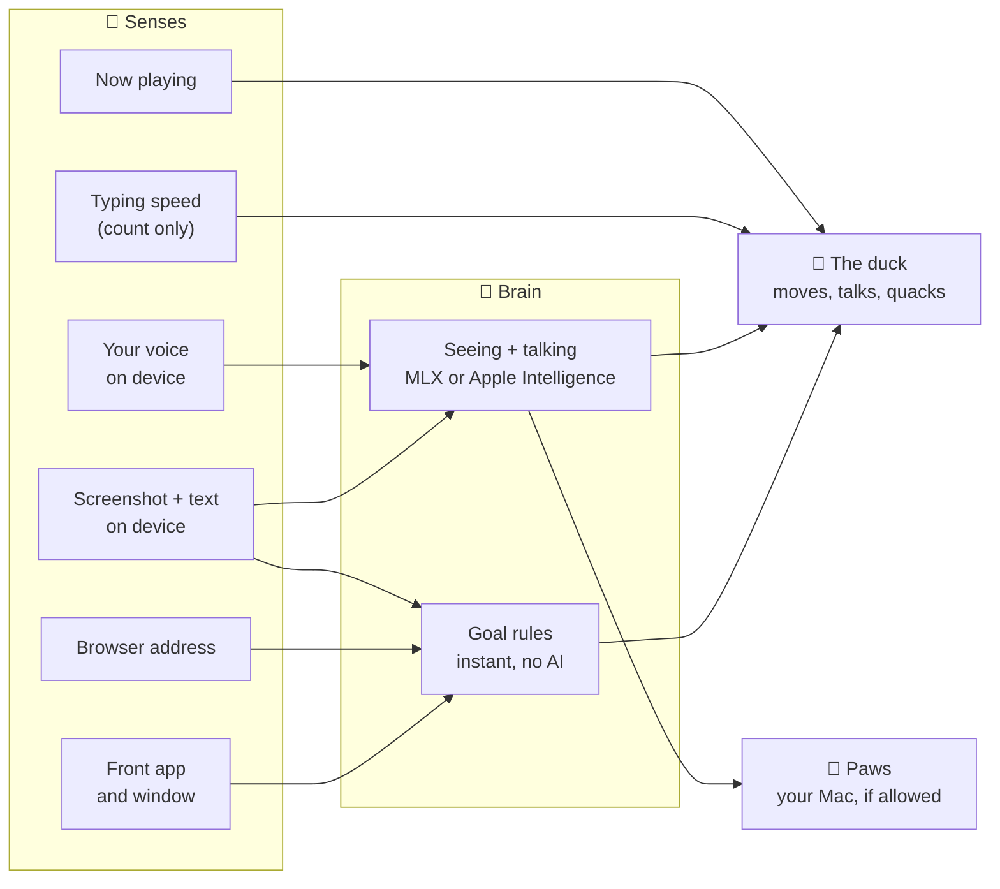

```
QuackieChan/
  App/        launch, menu bar, shortcuts, fonts
  Duck/       pixel art, animation, moods, sounds and voices, the views, the talk box, physics and antics
  Senses/     the front window, browser, screenshots and text, typing, music, speech, and its hands (Paws)
  Brain/      goals and rules, prices, lines, reactions, what it knows, the director, the AI minds
  Settings/   settings and the settings window
  Fonts/      Fredoka
  Sounds/     the quack and the gunshot
QuackieChanTests/   unit tests
scripts/            build.sh, make-icons.sh
```

</details>

### Making a release

Releases are signed with a Developer ID certificate and notarized by Apple, so macOS opens them without warnings even when they're downloaded in a browser. Every release is built the same way, so the duck keeps its permissions (Screen Recording, Accessibility) across updates.

Once, save your notarization login in the keychain. Make an app-specific password at [account.apple.com](https://account.apple.com) → Sign-In and Security → App-Specific Passwords, then:

```sh
xcrun notarytool store-credentials quackie-notary --apple-id <your Apple ID> --team-id 537P4FPMZ4
```

For each release, bump `MARKETING_VERSION` in `project.yml`, commit, and run:

```sh
./scripts/release.sh
```

Without an active Apple Developer Program membership, Apple won't notarize. Run `./scripts/release.sh --without-notarizing` instead: it still signs with the Developer ID certificate, so the signature stays the same once notarizing is back.

It builds the app, packs it into `QuackieChan.dmg`, has Apple notarize it, staples the ticket on, tags the commit and publishes a GitHub release with the disk image and `appcast.xml`. The install script downloads the newest disk image; the app itself finds new versions through the appcast ([Sparkle](https://sparkle-project.org)). To only make the disk image, run `./scripts/make-dmg.sh --notarize` (or without `--notarize` for a quick local copy).

The appcast is signed with a Sparkle key kept in the maintainer's keychain; its public half is `SUPublicEDKey` in `project.yml`. **Back it up** (`build/DerivedData/SourcePackages/artifacts/sparkle/Sparkle/bin/generate_keys -x sparkle-key.txt`, then somewhere safe): without it, copies already out there can't update. Updates work without notarization too, as long as releases keep being signed with the same Developer ID.

<br>

## 📄 License

**[MIT](LICENSE)**. Have fun with it.

Third-party bits keep their own licenses: the [Fredoka](https://fonts.google.com/specimen/Fredoka) font (SIL Open Font License, `QuackieChan/Fonts/OFL-Fredoka.txt`), the Swift packages, and each downloadable model (shown next to it in the app).

<div align="center">
<br>

<br>
<sub>Made with bread by Patrick Jakobsen</sub>
</div>
